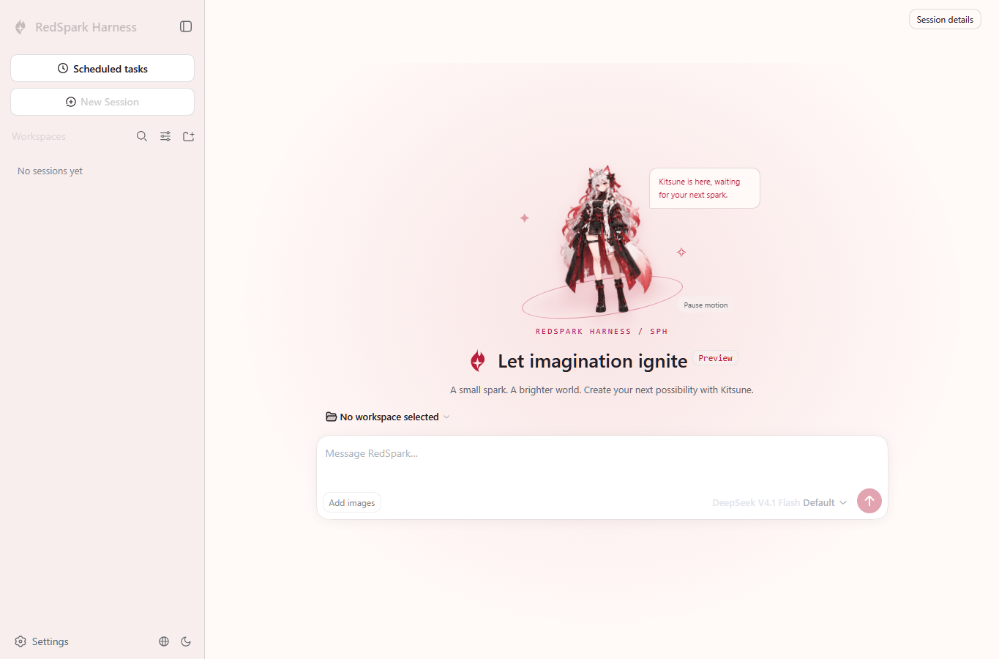

# Native source resolution verification

## Scope

This is a fixed verification record for [PR #216](https://github.com/Little-Red-Cre-Org/RedSparkHarness/pull/216). The configuration and Agent Note content exercised by the checks and capture was committed as `a6e9c879f64c2179045242535f1881da9b59cada`, based on `1d8d6b0d68af7446d38244b227ff6ddbf0840001`. The capture occurred before that commit, with the same configuration bytes; [results.json](results.json) records their SHA-256. Subsequent evidence publication changes no production files. This record is not a claim that every repository check passes.

## Native startup



The official `native-web` profile returned HTTP 200 and boot state `ready`, with no page errors or alerts. A fresh isolated home and browser context were used; only Continue and Configure later were clicked. No credential was configured, no prompt was sent, no model call was made, and no fixture or mock was used. The screenshot proves startup only. Its capture time, dimensions, byte count and SHA-256 are in [results.json](results.json); PNG chunks contain no text or EXIF metadata.

## Local results

The environment was Windows, Node 24.14.1 and pnpm 11.28.5. All eight actual source imports succeeded before a workspace `lib/` build. Cordis configuration validation passed for 150 configurations; the three focused source test files passed all 24 tests. Quick documentation checks passed all 17 checks. Full lint and the normal pre-commit and pre-push typecheck hooks exited 0. Documentation typecheck, documentation build and export JSDoc also passed in the complete run.

`pnpm run check:all` ran all 61 checks to completion: **52 passed, 9 failed, 0 skipped**, exit 1, 1277.95 seconds. [results.json](results.json) contains every check's command, status and exit code, plus the original local log's SHA-256. Raw logs, private filesystem paths and authenticated URLs are omitted.

| Failed check | Observed failure |
| --- | --- |
| Client domain graph | 25 existing ownership edges in InputBar and document preview. |
| Unit tests | 35 failed files, 77 failed tests and one unhandled error; assertions, stale Desktop mock, pre-build entry failures and default-timeout failures. The differing cases were examined below. |
| Duplication | 78 existing clones. |
| Session snapshots | Existing recorded-profile replay and minimal-preset failures. |
| Process expectations | Native image-offload and one-shot pi-ai DeepSeek compatibility expectations. |
| Publint | Existing `./src/*` exports do not match packaged files. |
| Optional dependency imports | Existing inventory points at `ui-trajectory/src/native.ts`; the source is `native.tsx`. |
| Client UI i18n | 35 existing hardcoded UI strings. |
| Module graph | Stale `rsh/Docs/module-graph.md`, `.zh.md` and `.i18n.yaml`. |

## Unit A/B

Only the differences between two aggregate unit-failure sets were selected. The original and proposed configuration used the same checkout, built artifacts and one worker, with unchanged tests and default timeouts. Each named-case run had 48 passes and 4 failures; each previously uncollectable import group passed 12 tests. Original configuration failures were two npm benchmark timeouts and two webworker-packer cases. Proposed configuration failures were one npm benchmark timeout, the Oxlint TypeGraph parser timeout and the same two webworker-packer cases. The Oxlint case then passed in isolation under both configurations. No alias-caused regression was reproduced; this does not turn the aggregate failures into passes. Exact selections and both comparisons are in [results.json](results.json).

## Recheck commands

Use a fresh checkout with Node 24, pnpm 11.28.5 and the platform's supported native-addon build tools. Run from the repository root. These are reproduction instructions; timing-sensitive failures can vary by machine. No API key or paid model invocation is required.

```powershell
pnpm install --frozen-lockfile --config.virtual-store-dir-max-length=32
pnpm run verify-cordis-config
pnpm run verify-tsconfig-paths
pnpm exec vitest run rsh/Scripts/gen-tsconfig-paths.spec.ts rsh/Scripts/verify-cordis-config.spec.ts rsh/Scripts/cordis-config-files.spec.ts --maxWorkers=1 --retry=0
```

Before building workspace libraries, verify that all eight imports resolve to their recorded source files:

```powershell
@'
import assert from 'node:assert/strict';
import { registerHooks } from 'node:module';
import { existsSync, readFileSync } from 'node:fs';
import { resolve } from 'node:path';
import { fileURLToPath } from 'node:url';
const records = JSON.parse(readFileSync('.github/pr-evidence/216-native-source-resolution/results.json')).sourceImportsBeforeBuild;
const observed = new Map();
registerHooks({ resolve(name, context, next) {
  const result = next(name, context);
  observed.set(name, result.url);
  return result;
} });
for (const record of records) {
  assert.equal(existsSync(resolve(record.expectedSource, '../../lib')), false);
  await import(record.specifier);
  assert.equal(fileURLToPath(observed.get(record.specifier)), resolve(record.expectedSource));
  console.log(record.specifier, 'source loaded; lib absent');
}
'@ | node --import tsx/esm --input-type=module
```

Run the complete inventory and the focused documentation/lint checks:

```powershell
pnpm run check:all
pnpm run test:docs
pnpm run lint
```

After the library build, replay the recorded A/B selections. The script preserves and restores the exact proposed configuration bytes with `finally`; it does not edit tests or increase timeouts. Set `$env:RSH_AB_FOLLOWUP = '1'` to run only the isolated Oxlint follow-up, and remove that environment variable to run the original difference selection.

```powershell
@'
import { execFileSync, spawnSync } from 'node:child_process';
import { readFileSync, writeFileSync } from 'node:fs';
const evidence = JSON.parse(readFileSync('.github/pr-evidence/216-native-source-resolution/results.json'));
const original = readFileSync('tsconfig.base.json');
const baseline = execFileSync('git', ['show', `${evidence.baseCommit}:tsconfig.base.json`]);
const followup = process.env.RSH_AB_FOLLOWUP === '1';
const names = followup ? evidence.unitAB.isolatedFollowup.names : evidence.unitAB.selection.names;
const files = followup ? ['rsh/Scripts/oxlint-contract.spec.ts'] : evidence.unitAB.selection.files;
const pattern = names.map(name => name.replace(/[.*+?^${}()|[\]\\]/g, '\\$&')).join('|');
function run(label) {
  const groups = [{ files, args: [`--testNamePattern=${pattern}`] }];
  if (!followup) groups.push({ files: evidence.unitAB.selection.importFailureFiles, args: [] });
  for (const group of groups) {
    const result = spawnSync(process.execPath, ['node_modules/vitest/vitest.mjs', 'run', ...group.files,
      '--maxWorkers=1', '--retry=0', ...group.args], { stdio: 'inherit', windowsHide: true });
    if (result.error) throw result.error;
    console.log(label, 'exit', result.status);
  }
}
try { writeFileSync('tsconfig.base.json', baseline); run('original'); }
finally { writeFileSync('tsconfig.base.json', original); }
run('proposed');
'@ | node --input-type=module
```

To inspect startup, use a new temporary home, launch the official profile and open its locally printed authenticated URL in a fresh browser context. Keep that URL out of published evidence. Follow the welcome flow, choose Configure later and send no prompt.

```powershell
$env:DSH_HOME = Join-Path ([IO.Path]::GetTempPath()) ('rsh-native-startup-' + [guid]::NewGuid())
node --import tsx/esm rsh/Programs/CLI/src/bin.ts --profile native-web
```
