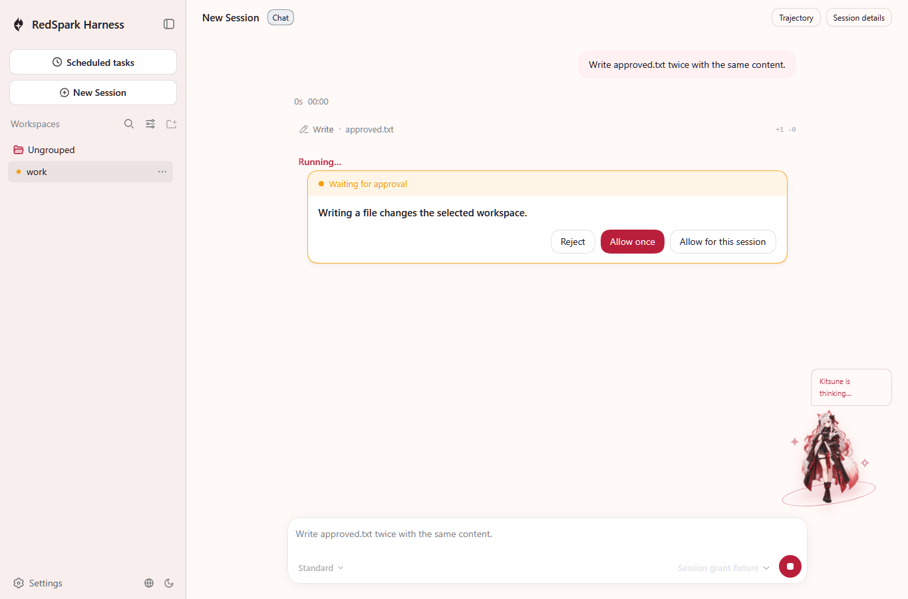
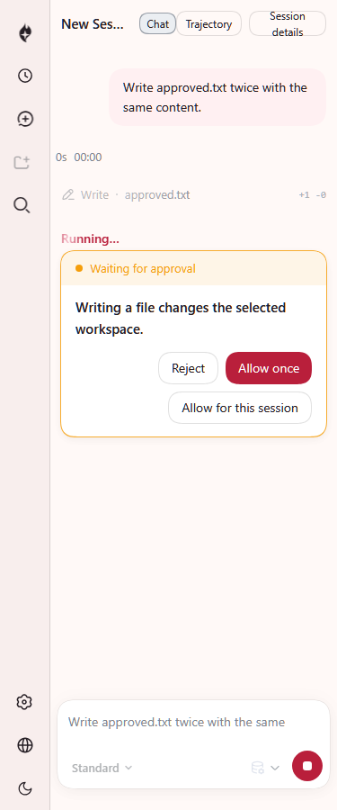
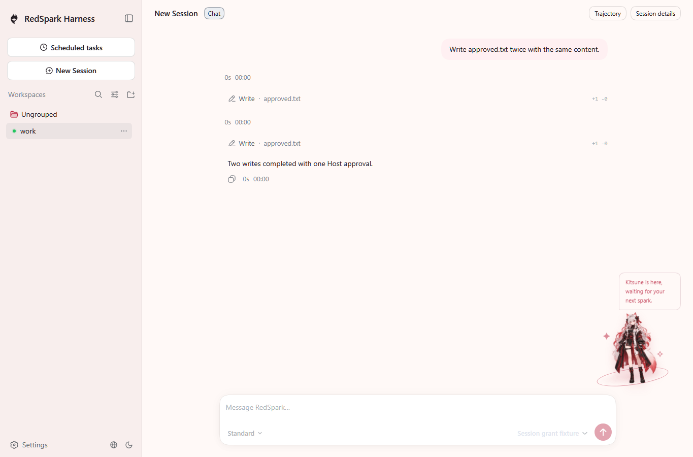
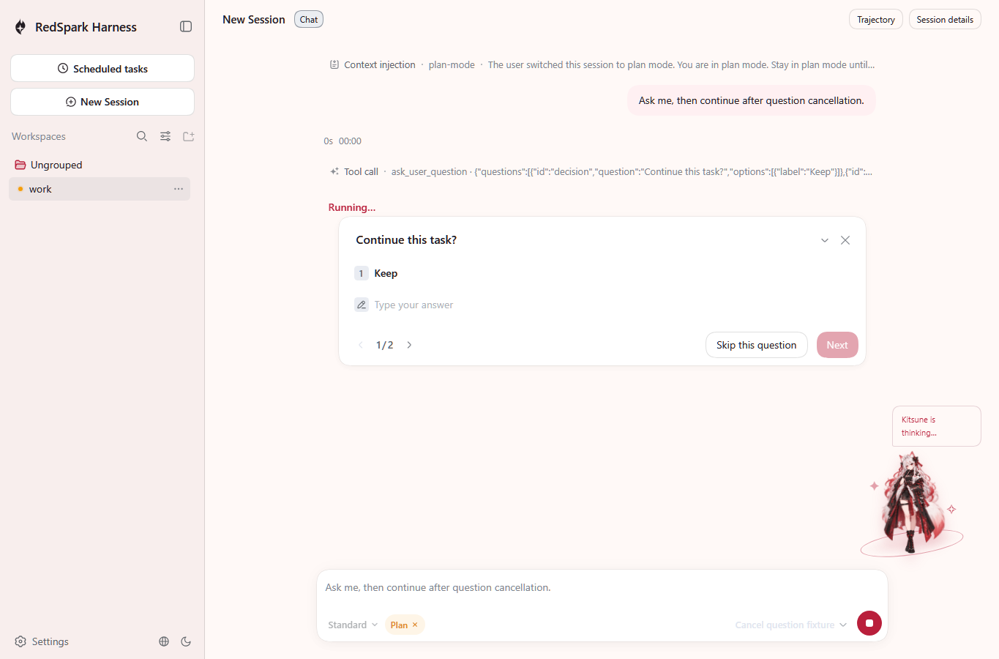
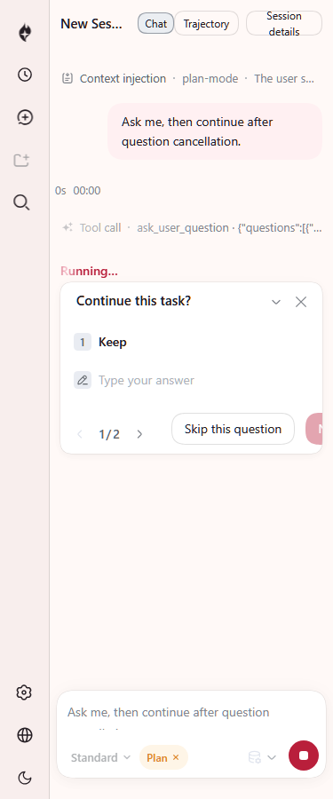
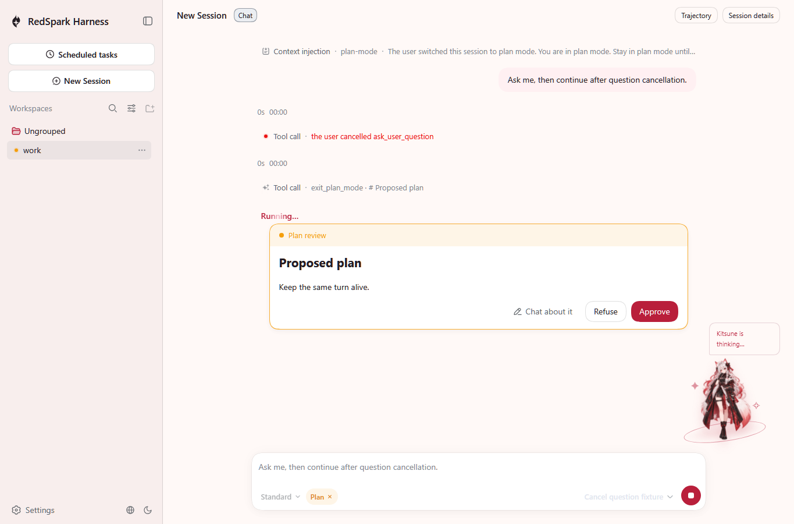
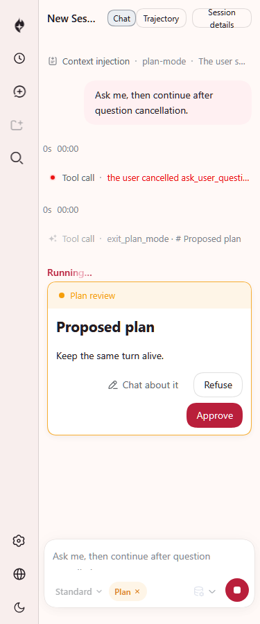
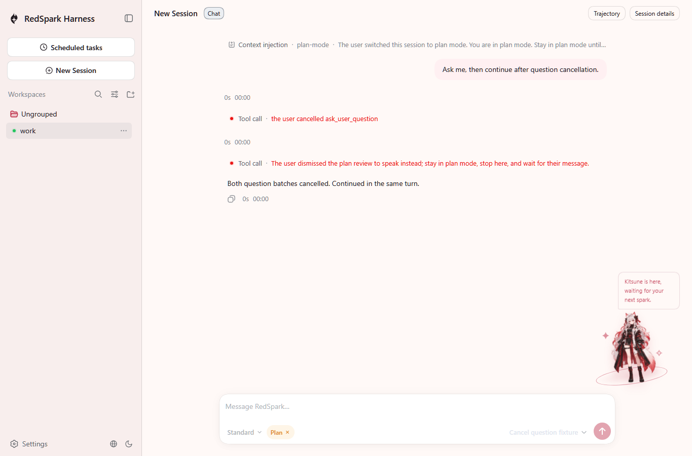

# Native human action buttons

The shipped Native Web cards now offer the Host-admitted Session approval action, dismissal of a whole pending question batch, and plan discussion. These unedited screenshots come from the real `dsh --profile native-web` CLI, its authenticated Host and official Playwright Chromium. The model is a local deterministic fixture; no credentials or paid model calls are used. Both scenarios retain the shipped fs-sandbox Provider in workspace-write mode. Production profile defaults are unchanged.

## Session approval

The browser clicks **Allow for this session**. The actual authenticated request carries `approval/allowed-session`; one human answer completes two equal file operations. The next model request contains both successful tool results. The durable Session records one grant and two allowed decisions, with no second grant. The actual `approved.txt` bytes match the independent [workspace oracle](../../../snapshots/web/native-session-grant/workspace.expected/approved.txt). [approval-browser-result.json](approval-browser-result.json) records the observed result without authentication values or local user paths.







The Session action is supplied only when `prompt.canAllowSession === true`; the shared card's existing Cordis decision callback still accepts only allow-once and reject.

## Question dismissal and plan discussion

The browser first clicks **Dismiss all questions** for a two-question batch, then clicks **Chat about it** on the real shipped `exit_plan_mode` review. A transparent fixture answerer delegates to the actual Host Provider and records its rejected waits: both original Provider errors are `ASK_CANCELLED`. The generic tool propagates that code. The existing plan Consumer converts its rejection into the discussion diagnostic; its durable error is `Error/UNKNOWN`, and the actual tool-result text tells the model to stay in plan mode and wait for the user's message. These are distinct observations, not two durable `ASK_CANCELLED` tool errors.

The actual third model request contains both error results. The same durable Session has one turn start and one completed turn end, while plan mode remains active. The browser observes two answer requests, zero whole-turn `session/cancel` calls, zero page errors and zero alerts. [question-browser-result.json](question-browser-result.json) preserves the tool results and original Provider cancellation observations. The [recorded Session](../../../snapshots/web/native-question-cancel/session.v3.jsonl) and its readable sidecars are the keyless replay inputs and expected outputs.











## State and layout boundaries

The controller keeps synchronous duplicate and stale-presentation checks. A failed acknowledgement retains the prompt and releases its submission controls. Delayed answers update errors or release the lock only for the captured Session and prompt; `human.id` still owns the React key. Only the Host removal frame clears a prompt. Generic dismissal uses the same Native `releaseBusyOnResolve` behavior as answering.

Desktop captures use 1365×900. Narrow captures use 375×900 after the existing automatic collapse settles to the 56px sidebar rail. The fixture waits for the rendered grid column rather than the display-contents Slot marker. The approval and plan action groups fit within the viewport and wrap when needed. Earlier captures during collapse or after manually expanding the narrow sidebar are not stable-page acceptance evidence.

This is **not acceptance of the entire page at 375px**. The generic question footer's disabled Next capsule is clipped in the narrow capture; its footer CSS is unchanged in this slice. That layout candidate is deferred for latest-main verification in the concentrated P2 batch. The dismissal control remains visible. No sidebar/layout, P5 assembly or unrelated P2 source change is included.

## Validation and delivery

Base: `73380d26c6376391655ae9b791f2680831d3c106`; Node `24.14.1`, pnpm `11.28.5`. Focused shared Cordis and Native state regressions pass 52/52. Both new state cases fail under the original main busy/ack logic, and the repaired files are restored byte-for-byte afterward. The real button scenarios refresh 2/2 and replay 2/2. Normal build and lint pass; their initial fixture type/style failures and separate corrected runs remain in the local logs.

The complete local `check:all` reached a terminal result: **53 gates passed, 8 failed, 0 skipped**. Its unit lane recorded 142 failed tests, snapshot lane 71, and expected-output lane 4. GUI completed with **5597 passed, 0 failed, 1 skipped**. All documentation gates, including doc-typecheck, translation pairing and export JSDoc, passed. [checks.json](checks.json) preserves the exact eight failed gates, raw counts, selected baseline file lists and classification limits. This full run predates the final owner-local settlement deduplication and remains a failed run.

After that minimal refactor, the same four Native/shared UI owner files pass **52/52**, normal `pnpm run build` and `pnpm run lint:contracts-ready` pass, and the two real button scenarios replay **2/2** against the fresh build. The added QuestionFlow clone is removed: duplication returns from 91 to the exact-base count of **90**, while that gate still fails on the existing baseline threshold. No unrelated duplicate source is changed.

A clean exact-base checkout has its own dependencies and normal build; no artifacts are borrowed from the proposal. Its domain graph's 25 violations, UI i18n's 35 strings, and Archify optional-import check's five findings match the proposal diagnostics line for line. Both module-graph checks report the same three stale documentation files. Selected baseline unit, snapshot and expected runs cover the exact file lists in `checks.json`. Unit comparison matches 98 failure headers and leaves 45 unmatched headers; these are headers, not a classification of all 142 failed tests. Snapshot comparison matches 70 headers. Both Native TUI cases pass in a narrow rerun; the two minimal-preset cases fail in both checkouts. All four expected-output failures match the selected baseline run. No same-command paired proposal unit run was performed.

The additional broad Web run was **interrupted, not passed** after about 42 minutes, with 42 completed file-result rows recorded. Its serial configuration inventories about 106 files, with a 180-second test timeout and 120-second hook timeout. Recent unrelated cases included startup selection, onboarding, paged stats and SVG delivery. The accompanying 17-file baseline browser subset was also interrupted after about 18 minutes and has no final JSON report or completed case-level comparison. Those observations are preserved in `checks.json`; no final whole-Web test totals or historical-failure classification are claimed. The earlier `0xC000026B` startup attempt did not enter tests and is excluded from all counts.

Four formal scenarios are changed or added: the two existing real Native browser scenarios and two parameterized Native state cases. Existing shared Cordis test cases remain unchanged. Runtime behavior, output and independent file/log observations are asserted; no new test framework is introduced.

All eight PNGs have been viewed and copied without editing. Their SHA-256 hashes and page descriptions are preserved in `screenshots.json`. Library's current upload helper reports `prepare_uploads` unavailable before saving anything; there are no confirmed new Library IDs. The exact committed PNG bytes are available for the main agent to retrieve and deliver through its supported Library environment.

Reproduce the button replay after a normal Node 24 build with official Chromium installed:

```powershell
$env:DSH_SNAPSHOT='replay'
pnpm exec vitest run --config vitest.web.config.ts rsh/Programs/Web/application/tests/native-session-grant.e2e.ts rsh/Programs/Web/application/tests/native-question-cancel.e2e.ts --retry=0
```

Set `DSH_SESSION_GRANT_EVIDENCE` and `DSH_QUESTION_CANCEL_EVIDENCE` to private output directories to capture the eight PNGs. Replay is read-only for the committed Session fixtures. Final independent CR, both required SPH platforms and merge remain with the main agent.
