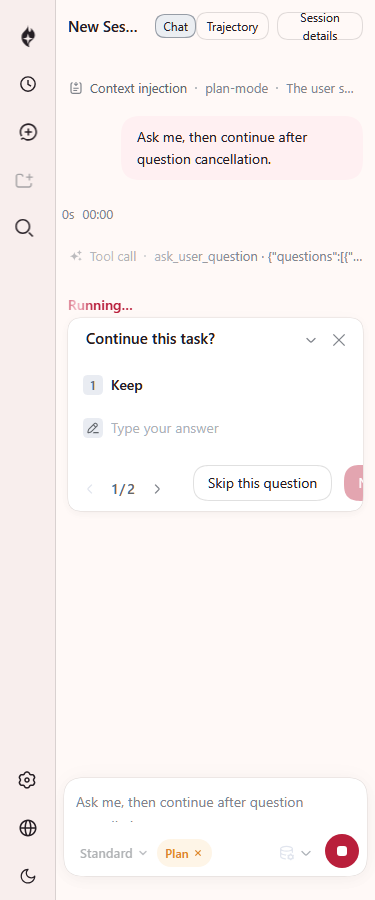
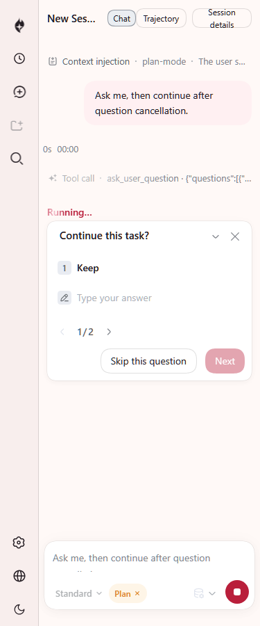
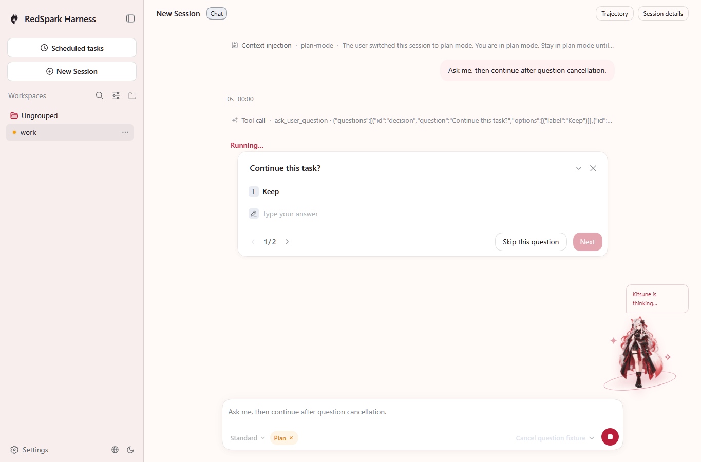
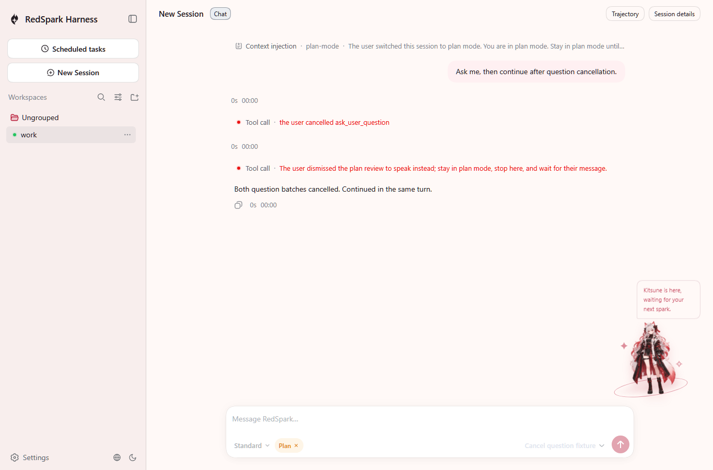
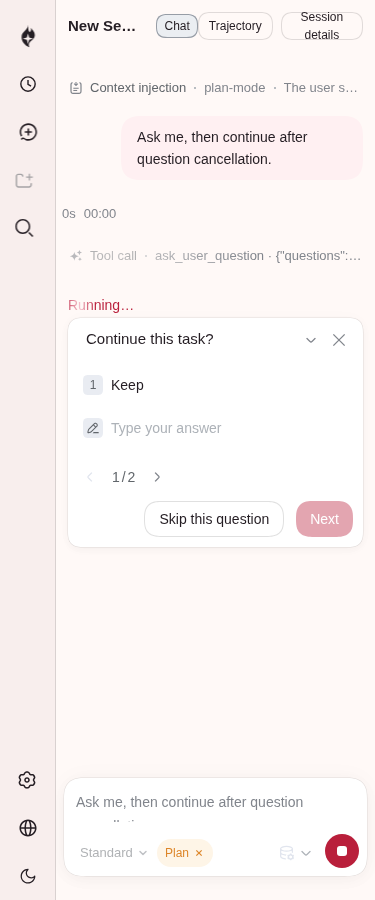
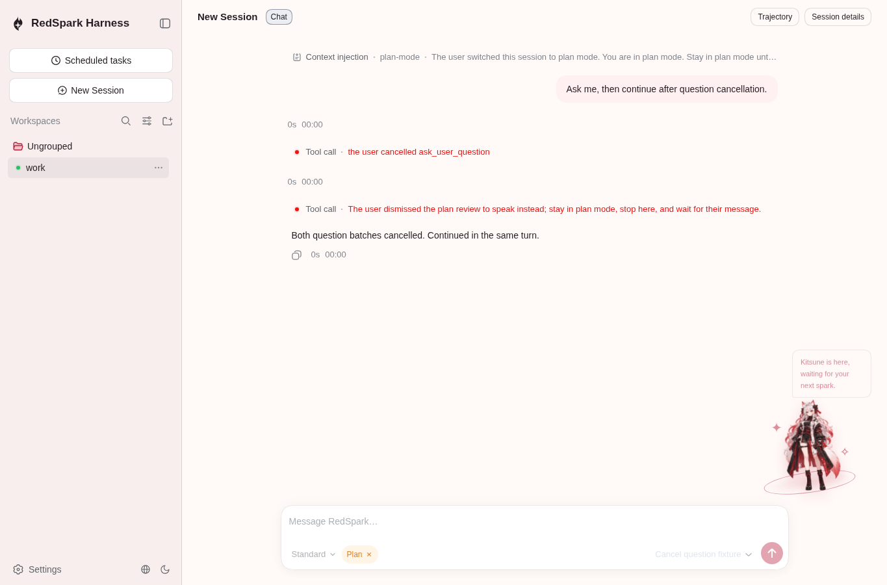

# Concentrated Native UI P2 repair

The repair addresses the six confirmed owner defects without changing the production assembly. Optional Settings absence now returns the existing empty description and configured limits, while actual provider failures and write/open-document refusals remain errors. Shared model and effort rows respect the current lock after catalog retry and keep an open menu during loading. The Native file panel preserves empty line pages, refreshes reopened directories, filters preview observations by absolute path/version, and binds pagination to the current preview read lifetime.

The narrow question footer now wraps. Both captures below come from the real `dsh --profile native-web` CLI, authenticated Host and official Playwright Chromium, after the automatic sidebar settles to its 56px rail. The model is a local deterministic fixture; no credentials or paid calls are used. The original main capture is from `e9a8e82bc7a8f935ef9cbf0396f269c5ce9756c2`; repaired captures are P2 WIP on that base, before the normal checkpoint `c902b698a96de54d663abe517bfbedc6eb303b20`. They are **not merged-base captures**. Current source head `deb7ab3a75f7c5643804347ffa6533b788d2f85e` includes main `29ab1728b0c50365a33d77cb1b12ae406efe551c`.

## Actual 375px result

## Real Native runtime

The existing real browser scenario passes before the merge (1/1 before and 1/1 after the footer repair). It clicks generic Dismiss and the shipped plan Discuss actions, then verifies actual tool results, one durable turn, zero whole-turn cancellations, zero browser errors and zero alerts. The merged-base attempt failed to start with `0xC000026B`, produced no test JSON or screenshots, and is not reported as a test pass or failure. The preserved images substantiate the footer repair and runtime; they do not visualize every Settings/model/files race or claim whole-page acceptance at 375px.

## Verification and limits

Four important scenarios fail on the original code and pass after repair. Their assertions cover absent Settings versus genuine errors/write refusals, locked model/effort rows and loading, blank-line/zero-line-EOF pagination and directory refresh, and observation filtering plus both obsolete page success and failure. The earlier complete owner set recorded 15 passed and one unrelated HTTP fixture failure; that one error was separately reproduced on an equal Git tree. The merged-base selection passes 4/4 with no new framework or wide browser comparison.

The original `check:all` process was interrupted after nine settled gates, before the expected-output outcome. All 52 missing gates were then run through the same exported repository runner, retaining the original nine outcomes. Coverage of all 61 original-base gates is complete across **two segments: 53 passed, 8 failed, 0 skipped**. It is not a single uninterrupted green run. Unit recorded 150 failures and snapshots 71; [checks.json](checks.json) retains exact gate outcomes, prior-run overlap, and classification limits. Normal lint passed. Duplication remains the existing 90-clone count.

After preserving the implementation in a normal hook-checked commit, latest main was merged forward without conflicts or history rewriting. Locked offline install, normal build and four affected scenarios pass. Merged-base doc-sync ended with **6 passed / 29 failed / 0 skipped**: doc-typecheck, documentation build, doc graphs, Markdown links, type equivalence and Cordis catalog passed; Cordis inspect exited 1073807364, followed by 28 process startup failures with 3221226091 (`0xC000026B`). Merged-base export JSDoc and the later documentation checks therefore remain incomplete. The old-base export JSDoc pass is retained separately. #224 adds feedback APIs and profile entries; the Settings and workspace-file contracts remain unchanged.

The user explicitly requested pushing the local work first for remote continuation. The draft handoff preserves all unfinished validation; normal commit/push hooks are required. Incoming-main CI risk reported by the main agent: [Windows run 38514984454](https://github.com/Little-Red-Cre-Org/RedSparkHarness/actions/runs/38514984454) failed `native-headless/tests/native.spec.ts:1539`, PTC false, at 5020ms against a 5000ms timeout. Ubuntu succeeded; the root cause is not classified and this P2 slice adds no broad investigation.

The [P2 ledger](p2-backlog.md) records the confirmed fixes and remaining review boundary. #219's evidence now distinguishes its direct registry/HTTP cases and Client exclusion/Host inclusion. #222's private checkedTarget comment now matches the original-target return and FS_STALE_VERSION identity refusal; no filesystem policy behavior is changed.

All four PNGs were viewed and copied without editing; [screenshots.json](screenshots.json) records their source commits and hashes. The main agent retrieves these exact committed bytes for Library delivery. The unsupported local Library helper is not retried. Independent CR, both required SPH platforms, and merge remain with the main agent.

## Cloud continuation on latest main

Source commit `12e2c7367b6977d3b7186a21083483349739ef9e` includes main `fa546a8641c5784963d92fdf32045fbda1bb1ec5` through a normal merge. It repairs first-read observation loss and HTML dependency invalidation in the existing file panel owner. The two review probes fail on the initial P2 source and pass on its predecessor; current owner checks pass 20/20. Normal build and lint pass; doc-sync completes 35/35, including export JSDoc and Cordis inspect. One preceding owner run times out the HTTP lifecycle case at 5000ms during concurrent lint; the final run uses the original budget without retries. These cloud outcomes supplement the original Windows results above; they do not rewrite them.

The locked Playwright Chromium download is denied with HTTP 403, and the official question replay has no executable-path override. The following independent QA uses system Chromium 154.0.8037.57, the exact source commit above and fresh Native CLI/Host state at `http://127.0.0.1:41671`. A copied fixture script in the ignored QA directory selects that executable, leaving the official test and production sandbox unchanged. The local deterministic model makes no credentialed or paid calls. The QA passes 1/1, records three model requests, both question cancellations, zero whole-turn cancellation calls, zero browser errors and zero alerts. This verifies the button flow and visible 375px footer; it does not visualize the file races or establish whole-page responsive acceptance. [Result and provenance](cloud-browser-result.json); byte hashes are in [screenshots.json](screenshots.json).

## Initially missing dependency recovery

Source commit `447828188cdb74785ac2477d2d482cefb4c65b7d` adds frontend recovery when the first HTML dependency read rejects before establishing an identity. The same existing-fixture parameter fails before the repair and passes afterward; matching known observations and absence observations do not retrigger the failed read. Successful previews retain the identity/version filter. The final owner run passes 21/21, normal lint passes and doc-sync passes all 35 gates. [checks.json](checks.json) records this follow-up separately. The images above retain their original source commits and do not claim to capture this additional recovery path. Host implementations, protocol types and the accepted Settings response are unchanged by this follow-up.
