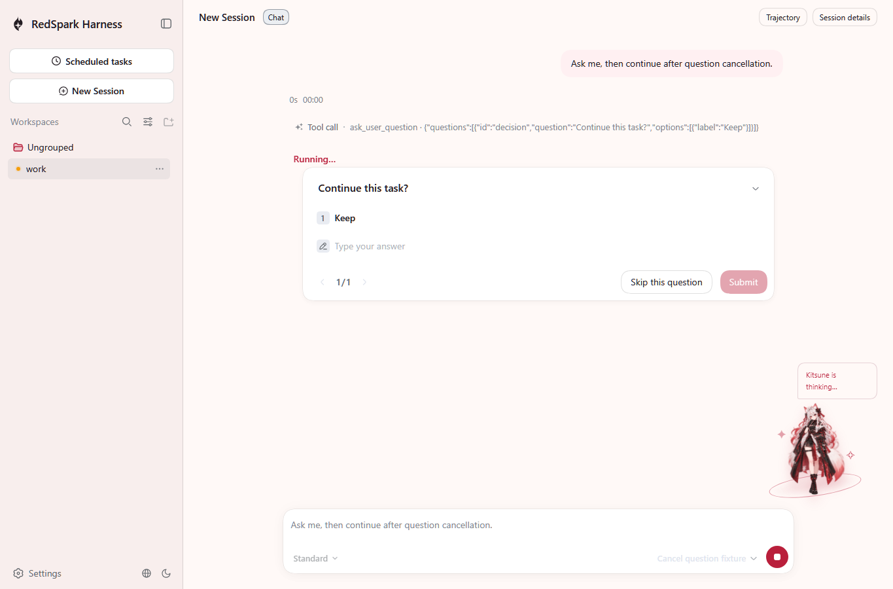
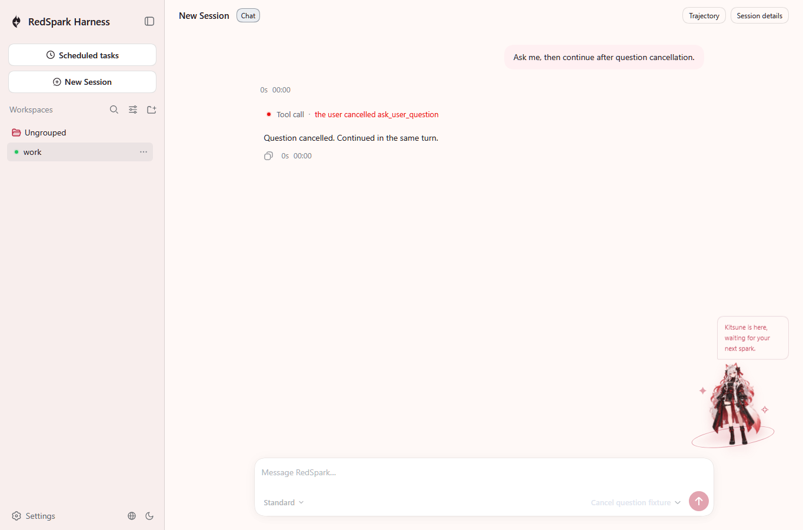

# Native question cancellation

These are unedited screenshots from the shipped `dsh --profile native-web` CLI and real Playwright Chromium, with the shipped Native Client roster and shared views. The model is a local deterministic fixture; no paid model call or API key is used.

The cancellation is a real authenticated `session/answer-human` Host RPC with `{ kind: 'cancel-questions' }`, carrying the active Session, admission and presentation identities. This PR adds the Host answer variant. The existing question UI remains visible in the first screenshot; its cancellation button belongs to a later slice. The existing “Skip this question” action was not used.

Before the Host call:



After the Host call, the question presentation is removed, the tool reports “the user cancelled ask_user_question”, and the next model step completes the same turn:



The browser fixture rejects unless its actual second model request includes the same `question` tool-result with `isError: true` and the cancellation text. Its durable Session has `error.code: ASK_CANCELLED`, exactly one `turn/start`, and one completed `turn/end`. It checks zero whole-turn `session/cancel` requests, zero browser errors and zero alerts. The model message carries the error text; the error code is a durable Session fact.

[Minimal browser result](browser-result.json) contains only this local fixture's result and no authentication cookie, token, admission id, user path or credential. The [recorded Session](../../../snapshots/web/native-question-cancel/session.v3.jsonl) and its prompt/schema sidecars are the keyless replay oracle.

Reproduce with Node 24 and the official Playwright Chromium installed:

```powershell
pnpm install --frozen-lockfile
pnpm run build
pnpm exec vitest run rsh/Programs/Web/api/native-web-session-controller/tests/question-cancel.host.spec.ts --maxWorkers=1 --retry=0
$env:DSH_SNAPSHOT='replay'
pnpm exec vitest run --config vitest.web.config.ts rsh/Programs/Web/application/tests/native-question-cancel.e2e.ts --maxWorkers=1 --retry=0
pnpm run check:all
pnpm run lint
```

To capture the two PNGs during replay, set `DSH_QUESTION_CANCEL_EVIDENCE` to a local output directory before the browser command. Replay compares the committed Session and does not rewrite it.

Capture base: `fea8345c629886d8470645603a7f3b5f80649523`. The production implementation is confined to the Web human-answer union and pending question settlement; the existing RPC, ownership checks, Provider, writer and view are reused.

## Validation

[Sanitized results](results.json) retain both complete 61-gate runs and log digests. The final run is **54 passed, 7 failed, 0 skipped**. Normal lint, one direct registry case and one authenticated HTTP case (2/2), Native replay (1/1), export JSDoc, doc-typecheck and documentation checks pass. All six gates skipped in the first run were executed in the final run. Optional imports and persistence catalog now pass.

The first run exposed an introduced test-build boundary error: this new browser test needed the same application Client exclusion and Host inclusion as the existing native conversation test. The correction preserves production checking. All 224 accidental source emits were matched to tracked TypeScript companions, hashed and archived outside source; the normal build and final full-run build then passed.

The seven remaining failures are unit tests, client domain graph, duplication, recorded snapshots, expected-output tests, client UI i18n and module graph. The same 44 unit files were tested on a clean exact-base checkout and the proposal, with Node 24, one worker and no retries: each ran 933 tests, with 95 failures shared by name. The proposal's one extra npm benchmark failure passed when isolated on both checkouts. This comparison does not prove every failure in the original 113-test or final 114-test broad runs is a baseline failure. Four structural checks also fail on clean base. The clean-base snapshot subset executed 10 of 12 requested files and failed 68 tests; the results retain the exact named overlap. All four expected-output failures also reproduce on clean base. Cases outside the matched subsets remain disclosed without a blanket baseline claim.
