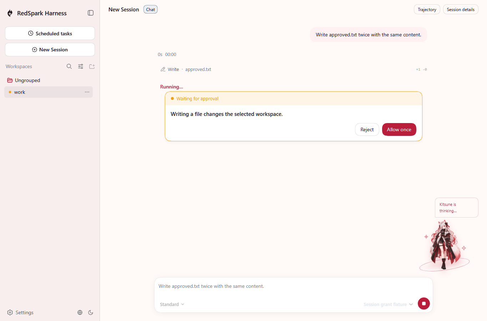
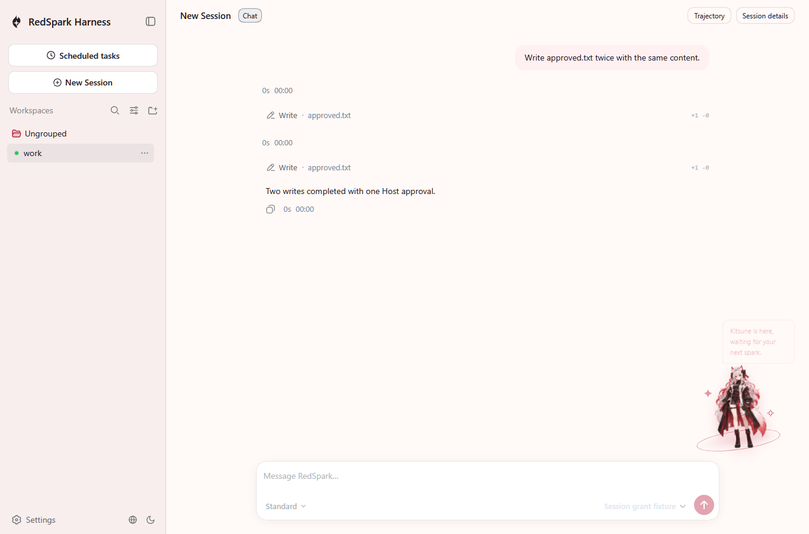

# Native Session approval scope

These unedited screenshots show the shipped `dsh --profile native-web` CLI, its real authenticated Host, the shipped Native Client roster and official Playwright Chromium. The model is a local deterministic fixture; no API key or paid model call is used.

The browser starts one turn containing two file writes with equal parameters in different object-key order. It sends one real authenticated `session/answer-human` Host request with `{ kind: 'approval', outcome: 'allowed-session' }`, using the live Session, admission and presentation identities. The current approval buttons remain unchanged; the screenshot's Allow once button is not used to choose the Session grant.

Before the Host answer:



After the Host answer, both writes complete without a second human answer:



The actual third model request contains two successful tool results. The durable log contains one remembered grant and two allowed decisions; the second decision adds no new grant. The actual `approved.txt` bytes match the independent [workspace oracle](../../../snapshots/web/native-session-grant/workspace.expected/approved.txt). The browser reports no page errors or alerts. [browser-result.json](browser-result.json) contains the local run's minimal result without authentication values or local user paths.

The [recorded Session](../../../snapshots/web/native-session-grant/session.v3.jsonl), prompt/schema sidecars and workspace oracle are the keyless replay inputs and expected outputs. Only the exact durable grant fingerprint receives an `approval-scope` identity token; distinct raw fingerprints remain distinct tokens. The real HTTP fixture separately checks eight distinct raw fingerprints and original Session identity retention across cold restore and fork.

Reproduce after a normal Node 24 build with official Playwright Chromium installed:

```powershell
$env:DSH_SNAPSHOT='replay'
pnpm exec vitest run --config vitest.web.config.ts rsh/Programs/Web/application/tests/native-session-grant.e2e.ts --retry=0
```

Set `DSH_SESSION_GRANT_EVIDENCE` to a private output directory during replay to capture the two PNGs. Replay compares the recorded Session and does not rewrite it. Capture base: `2e55ca187716ceb69bfc5f2fab1532d1f1ab80b8`.

Evidence scope: three new authenticated HTTP scenarios cover scope changes, missing/incomplete context, one-call escalation, cold restore/fork/new Session isolation, policy precedence and grant decision flush failure. A direct Registry assertion covers delegated candidate exclusion. The ten existing approval service unit tests remain unchanged. One new real CLI browser scenario owns recording and replay. Complete delegated entry approval behavior is not claimed by the new Registry check.

## Validation

Node `24.14.1`, pnpm `11.28.5`, official Playwright Chromium; normal hooks remain enabled. [results.json](results.json) preserves the original full run and the separate repaired gates and comparisons. The original `check:all` run reports 53 passed, 8 failed and 0 skipped in 1170.96 seconds. Its introduced persistence-catalog failure is repaired by the official generator; that gate, export JSDoc, all 35 doc-sync gates, all 45 owning runtime tests and the final browser replay pass afterward. The original eight-failure result is not rewritten as green.

Actual validation commands from the repository root:

```powershell
$env:NODE_OPTIONS='--max-old-space-size=4096'
$env:VCToolsVersion='14.44.35207'
$env:DSH_OXLINT_THREADS='2'
$env:DSH_GATE_CONCURRENCY='1'
pnpm run build
pnpm run lint
pnpm run check:all
pnpm run gen-persistence-catalog
pnpm run verify-translation-pairing --write rsh/Docs/persistence-catalog.md
pnpm run verify-persistence-catalog
$env:DSH_DOC_TYPECHECK_USE_BUILD_OUTPUT='1'
pnpm run doc-sync
pnpm run verify-export-jsdoc
pnpm exec vitest run rsh/Programs/Web/api/native-web-session-controller/tests/session-grant.host.spec.ts rsh/Modules/Official/interaction/native-approval/tests/native.spec.ts rsh/Engine/core/native-headless/tests/native.spec.ts --maxWorkers=1 --retry=0 --reporter=json --outputFile=output/playwright/grant-owning-regression-final.json
$env:DSH_SNAPSHOT='replay'
pnpm exec vitest run --config vitest.web.config.ts rsh/Programs/Web/application/tests/native-session-grant.e2e.ts --retry=0
```

Baseline comparisons use an independently built, clean checkout at `2e55ca187716ceb69bfc5f2fab1532d1f1ab80b8` with its own dependencies. The following commands reproduce the exact selected file sets from `results.json`; on the baseline, read that file through its absolute path in the grant checkout. Paid-provider credentials are absent and there is no API-key `.env` file in either checkout.

```powershell
$comparison=Get-Content -Raw .github/pr-evidence/native-session-grant/results.json | ConvertFrom-Json
$unitFiles=$comparison.unitComparison.files
pnpm exec vitest run @unitFiles --maxWorkers=1 --retry=0 --reporter=json --outputFile=output/playwright/grant-baseline-unit-failures.json
pnpm exec vitest run @unitFiles rsh/Programs/Web/api/native-web-session-controller/tests/session-grant.host.spec.ts rsh/Modules/Official/interaction/native-approval/tests/native.spec.ts rsh/Engine/core/native-headless/tests/native.spec.ts --maxWorkers=1 --retry=0 --reporter=json --outputFile=output/playwright/grant-proposal-paired-unit.json
$snapshotFiles=$comparison.snapshotComparison.files
$env:DSH_EXAMPLE_MODE='lib'
$env:DSH_SNAPSHOT='replay'
pnpm exec vitest run --config vitest.snapshot.config.ts @snapshotFiles --maxWorkers=1 --retry=0 --reporter=json --outputFile=output/playwright/grant-baseline-snapshot.json
$expectedFiles=$comparison.expectedComparison.files
pnpm exec vitest run --config vitest.expected.config.ts @expectedFiles --maxWorkers=1 --retry=0 --reporter=json --outputFile=output/playwright/grant-baseline-expected.json
pnpm exec vitest run rsh/Modules/Official/attachment/attachment-local/tests/request-image.spec.ts rsh/Scripts/benchmark-npm-resolution.spec.ts --maxWorkers=1 --retry=0 --reporter=json --outputFile=output/playwright/grant-isolated-proposal.json
pnpm exec vitest run --config vitest.snapshot.config.ts rsh/Programs/Web/application/tests/minimal-preset.snapshot.ts snapshots/native-tui/commands-presets.snapshot.ts snapshots/native-tui/native-tui.snapshot.ts snapshots/native-tui/preset-controls.snapshot.ts --maxWorkers=1 --retry=0 --reporter=json --outputFile=output/playwright/grant-proposal-snapshot-differences.json
```

The 45-file paired unit comparison records 100 failures on each side and 99 common cases. The proposal-only image-cache rename `EPERM` reproduces on main in isolation; proposal isolation passes. Both isolated npm benchmark runs pass. This does not classify every one of the 122 original full-run unit failures as baseline. The failed snapshot subset reproduces 70 failures on main, including the two minimal-preset cases. The three full-run TUI differences pass narrow replay on both sides. The four expected-output failures reproduce on main. Domain-graph and UI-i18n failures, 90 duplication clones, and the same three stale module-graph documents also reproduce on main. Those unrelated modules remain unchanged.
