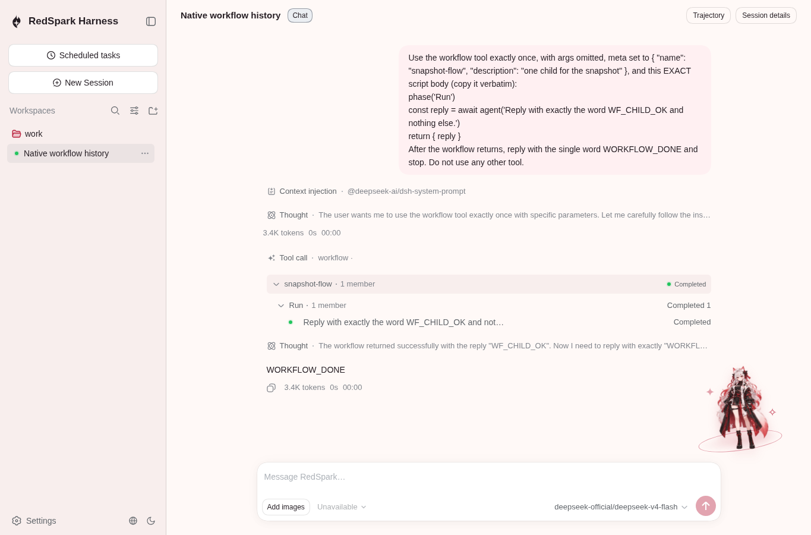
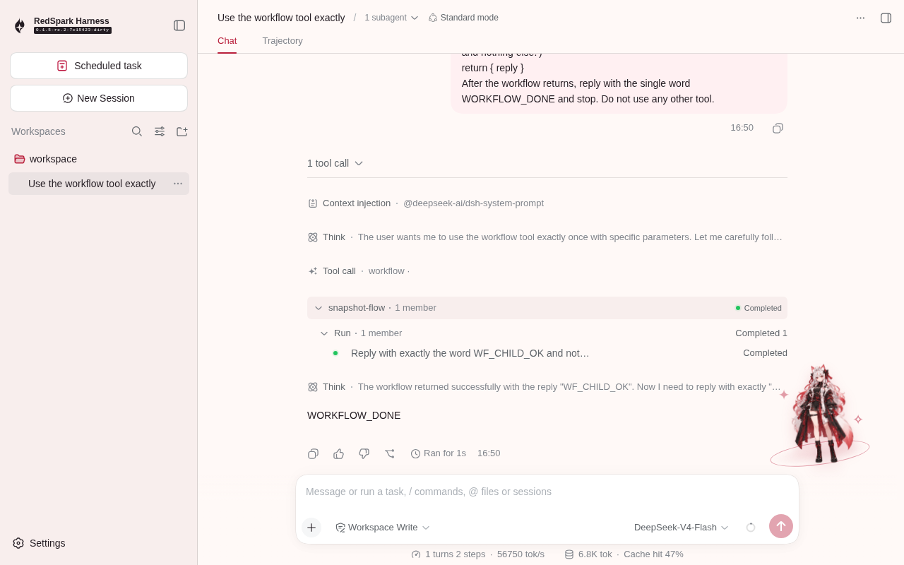

# Native workflow runtime evidence

[PR #228](https://github.com/Little-Red-Cre-Org/RedSparkHarness/pull/228) initial implementation checkpoint is `18a305983ef18579c86e885ca72abffa78d7755e`, based on exact main `7c15423eff5569180e3a9024277ab8397b26649e`. This evidence-only publication preserves earlier WIP captures unchanged; it is not a new browser verification of the final source or of this documentation commit.

## Real Native CLI and Host

The captures use the real built `dsh --profile native-web` CLI, its authenticated Host controls/history RPC and the shipped Native Client roster. A local deterministic fixture is configured; no task is submitted and no model request is made. The existing recorded workflow parent is materialized with the real JSONL backend into temporary `/tmp/rsh-web-profile-*/sessions/` storage before launch. The fixture's exact normalized system text and an explicit workspaceRoutes configuration permit cold history restoration. These images show one completed run, its phase/member rows, the ordinary workflow tool card, and no child navigation. They do not demonstrate live Native workflow execution or the later session-level anchor fallback.

## Cordis shared-view replay

The existing Cordis workflow scenario runs real workflow/tool/worker/Session and navigation behavior with recorded parent/child model fixtures; its three workflow tests passed. The same system-browser invocation's unrelated Native full-flow test timed out at Model menu, before its workflow history block. That timeout has not been reproduced on exact main.

All three images use system Chromium `154.0.8037.57`, explicitly `/usr/bin/chromium`. They are separate supplementary QA, not official pinned-Chromium replay. Captures predate the first implementation commit; no exact immutable capture source tree was recorded. [Source and hashes](screenshots.json), [detailed provenance](validation.md), [checks summary](checks-summary.md), [P2 ledger](p2-backlog.md), and original [logs](logs/) retain these limits. The exact Native capture script and temporary browser override are also preserved as text for inspection.

The latest implementation source is `1eb5ae8518df47614a5265da4e0e358dd4a84157`, which repairs the two confirmed P2 defects in ordering and cross-Session disclosure state. Its four focused regressions pass on that immutable commit; it has no new browser captures. The subsequent evidence-only commit is separate.
