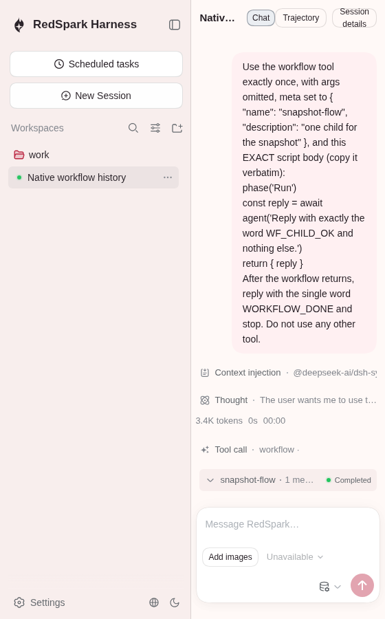
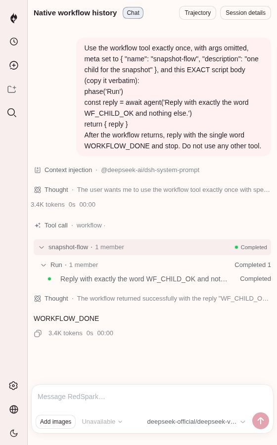

# Native workflow runtime evidence

[PR #228](https://github.com/Little-Red-Cre-Org/RedSparkHarness/pull/228) initial implementation checkpoint is `18a305983ef18579c86e885ca72abffa78d7755e`, based on exact main `7c15423eff5569180e3a9024277ab8397b26649e`. The original evidence publication at `943d452f42` preserves the earlier WIP captures unchanged; those historical images are not browser verification of the final source or of the documentation commit. The current-source recapture is distinguished below.

## Real Native CLI and Host

The captures use the real built `dsh --profile native-web` CLI, its authenticated Host controls/history RPC and the shipped Native Client roster. A local deterministic fixture is configured; no task is submitted and no model request is made. The existing recorded workflow parent is materialized with the real JSONL backend into temporary `/tmp/rsh-web-profile-*/sessions/` storage before launch. The fixture's exact normalized system text and an explicit workspaceRoutes configuration permit cold history restoration. These images show one completed run, its phase/member rows, the ordinary workflow tool card, and no child navigation. They do not demonstrate live Native workflow execution or the later session-level anchor fallback.

## Cordis shared-view replay

The existing Cordis workflow scenario runs real workflow/tool/worker/Session and navigation behavior with recorded parent/child model fixtures; its three workflow tests passed. The same system-browser invocation's unrelated Native full-flow test timed out at Model menu, before its workflow history block. That timeout has not been reproduced on exact main.

All three images use system Chromium `154.0.8037.57`, explicitly `/usr/bin/chromium`. They are separate supplementary QA, not official pinned-Chromium replay. Captures predate the first implementation commit; no exact immutable capture source tree was recorded. [Source and hashes](screenshots.json), [detailed provenance](validation.md), [checks summary](checks-summary.md), [P2 ledger](p2-backlog.md), and original [logs](logs/) retain these limits. The exact Native capture script and temporary browser override are also preserved as text for inspection.

The latest implementation source is `1eb5ae8518df47614a5265da4e0e358dd4a84157`, which repairs the two confirmed P2 defects in ordering and cross-Session disclosure state. Its four focused regressions pass on that immutable commit. The original evidence-only publication is separate; the current-source recapture below follows that publication.

## Current exact-source Native recapture

These new captures use source `943d452f42ef24084819045b19bf535ab5cf06cc`, whose product source is identical to repair `1eb5ae8518df47614a5265da4e0e358dd4a84157`. The Native application and shared workflow Client artifacts were rebuilt on that exact HEAD, then the preserved real CLI/Host history fixture was run with capture-navigation changes only. No UI, interface or image edits were made. Old images above remain historical; this new run does not relabel them.

In the normal narrow state, the existing responsive layout has collapsed the sidebar. Scrolling the actual Workflow/member into view gives panel bounds x=68…548, y=484…576 in a 560×900 viewport; both disclosures remain expanded. The completed member is visible. The first added navigation attempt timed out waiting for a Collapse sidebar button because the layout had already collapsed; its failure is retained separately. The successful attempt observes that state instead of forcing the UI.

[Exact source, build commands, artifact/image hashes and temporary fixture paths](current-head-capture.json), [build log](logs/current-client-build.log.gz), [first-attempt failure](logs/current-head-capture.log.gz), [successful runtime result](logs/current-head-capture-final.log.gz), and [executed capture source](qa-current-head.capture-source.txt) retain the details. The browser is explicitly `/usr/bin/chromium`, system Chromium `154.0.8037.57`; no model request is submitted. This is supplementary restored-history QA, not official pinned-browser replay or live workflow execution.

The just-resized sidebar-open PNG was freshly captured but is byte-identical to the historical narrow image; both depict the same pre-collapse viewport state. The current collapsed/scrolled narrow image is distinct. The manifests record this equality instead of presenting the duplicated pixels as additional visual coverage.
